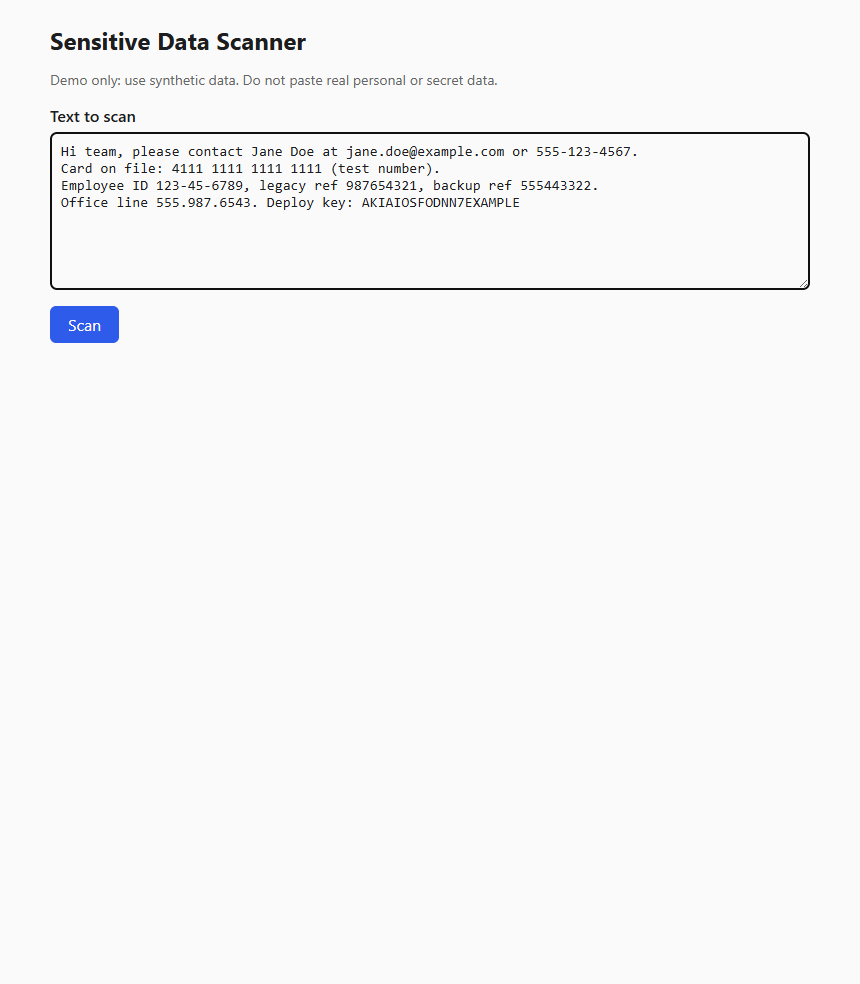
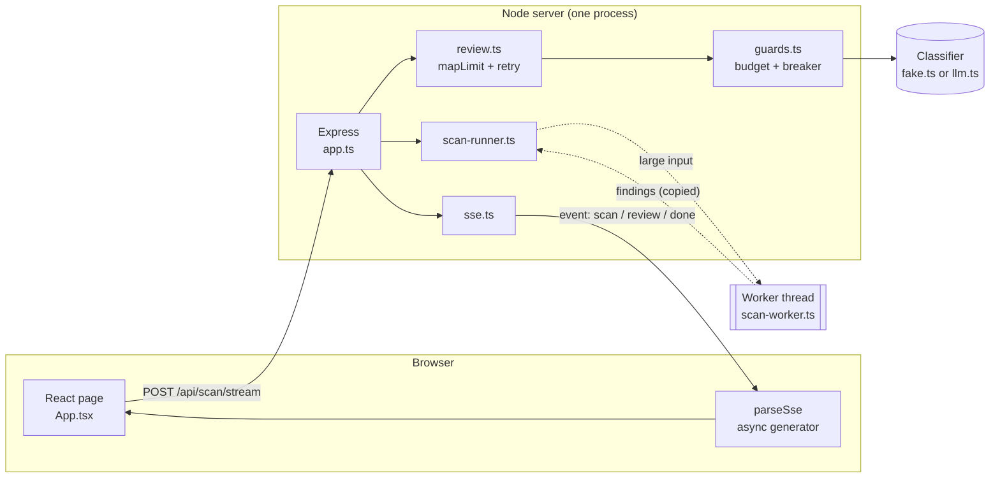

# pii-scout - Sensitive Data Scanner

A small full-stack TypeScript app that scans text for sensitive data (emails, phone numbers, card numbers,
API keys, ID numbers). Fast rules find candidates; ambiguous ones are sent to an LLM-style reviewer, and
results stream to the browser as they finish.



**Live demo:** <https://scanner-crgz.onrender.com> · [full-size screenshot](docs/screenshot.png)

> **Note:** the demo runs on Render's free plan, which puts the service to sleep after about 15 minutes without traffic. The first request after that can take around 60 seconds while it wakes up; after that it is fast.

> **Synthetic data only.** Do not paste real personal or secret data. By default the "LLM" is a free
> dummy, so no text is ever sent to a third-party AI service.

It is also a learning project about the **Node.js runtime**: the event loop, worker threads, streaming,
cancellation, bounded concurrency and fail-safe design. See [Node runtime notes](#node-runtime-notes).

## Run it locally

Requires Node 24 (see `.nvmrc`).

```bash
# terminal 1: API on :3000
cd server && npm install && npm run dev

# terminal 2: UI on :5173 (proxies /api and /health to :3000)
cd web && npm install && npm run dev
```

Open <http://localhost:5173>. Checks: `npm run lint`, `npm run typecheck`, `npm test`, `npm run build` in each package.

## Architecture



### Repo layout

```text
server/src/
  index.ts        entry: reads env, wires everything, listens on 0.0.0.0:$PORT
  app.ts          Express routes: /health, POST /api/scan, POST /api/scan/stream, static files in prod
  scanner.ts      pure rules: regex + Luhn check -> Finding[]
  scan-runner.ts  runs the scanner inline or in a worker thread
  scan-worker.ts  the worker thread's entry file
  review.ts       privacy masking, sends ambiguous findings to the classifier
  async.ts        sleep, retry (exponential backoff), mapLimit (concurrency cap); all abort-aware
  guards.ts       SpendBudget + CircuitBreaker, wrapped around any classifier
  fake.ts         free dummy classifier: random latency, answers and failures
  llm.ts          real Anthropic classifier (optional)
  sse.ts          Server-Sent Events helper with heartbeat
  cpu.ts          burnCpu(): fake CPU load for the event-loop demo
web/src/
  App.tsx         the page and its state machine
  sse.ts          parseSse(): async generator turning a byte stream into events
  segments.ts     splits text into plain / highlighted pieces
```

### Request flow (`POST /api/scan/stream`)

1. The browser sends `{ text }`. Zod validates it (1 to 100,000 characters; body capped at 200 kB). Invalid input gets a plain JSON `400` before any stream starts.
2. `runScan` scans the text. Short input runs inline; input of `WORKER_MIN_CHARS` or more runs in a worker thread.
3. The server sends `event: scan` right away with every rule-based finding, so highlights appear immediately.
4. For each **ambiguous** finding, `review.ts` builds a masked snippet and asks the classifier, with at most 4 calls in flight and 2 retries with backoff. Each result is sent as `event: review` the moment it settles, so results can arrive out of order.
5. `event: done` closes the stream. If the user cancels or disconnects, everything in step 2 to 4 is aborted.

Two request shapes exist on purpose: `/api/scan` waits and returns one JSON object (simple clients, tests), and `/api/scan/stream` is the streaming one the UI uses.

### Privacy

The reviewer never receives raw values. It gets about 40 characters of context in which the candidate is
**shape-masked** (`987654321` becomes `999999999`) and other findings are replaced by placeholders such as
`[EMAIL]`. Error responses never echo user input, and logs never contain input text.

### Safety guards (when the server stops to protect you)

Both wrap whatever classifier is configured, so they work for the dummy and the real one.

| Guard | Trips when | What happens |
| --- | --- | --- |
| **Spend budget** | Cumulative cost (every attempt, retries included) would pass `LLM_BUDGET_UNITS` | Reviews are refused instantly (never retried); rule-based results still return, with the reason shown in the UI |
| **Circuit breaker** | `BREAKER_THRESHOLD` consecutive provider failures | Provider calls stop for `BREAKER_COOLDOWN_MS`, then a single probe is allowed; success closes it, failure re-opens it |

The server degrades instead of crashing. `/health` shows both states. The budget is in-memory (no database
by design), so it resets on restart; with a real provider, also set a spend cap on the provider's side.

### Abuse limits

- **Rate limit:** a fixed-window counter per IP (`limits.ts`); over the limit gets `429` with `Retry-After`. It runs before the body parser, so a refused request costs almost nothing. Expired entries are swept lazily, so the map cannot grow forever.
- **Stream cap:** each open stream holds a connection and up to 4 review calls, so open streams are capped per IP and overall. The slot is released on the response's `close` event, which fires on normal end, error and client abort.
- **Proxy gotcha:** behind Render every request arrives via the proxy. Without `trust proxy` all visitors share one IP (and one limit); trusting too many hops lets clients spoof `X-Forwarded-For`. Both cases are tested in `app.limits.test.ts`.
- **Where the counters live:** in this process's memory by default (resets on deploy, not shared between instances), or in Redis when `REDIS_URL` is set, see below.

### Shared state with Redis (optional)

With `REDIS_URL` set, the three pieces of state that must be shared across instances move to Redis (`redis-stores.ts`); without it the app uses the in-memory versions, so local development needs nothing. Both satisfy the interfaces in `stores.ts` (return type `T | Promise<T>`, so the in-memory classes stay synchronous).

| State | Redis approach | If Redis is down |
| --- | --- | --- |
| Rate limit | `INCR` + `PEXPIRE` in one Lua script, so a crash cannot leave a key that never expires; Redis deletes expired windows itself | **Fail open**: allow the request, log a warning |
| Stream slots | Per-IP and total counters with a TTL, so slots leaked by a crashed instance heal themselves | **Fail open** |
| Spend budget | Monthly key `spend:YYYY-MM`; check-and-add in one Lua script, so concurrent instances cannot overspend | **Fail closed**: refuse the review ("could not be verified"); protecting money is the point |

Lua scripts run atomically inside Redis, which is what makes these safe across processes. Tests run the same suite against a real Redis in CI (`TEST_REDIS_URL`) and against `ioredis-mock` locally, including a test that ten concurrent charges against a budget of five produce exactly five successes. The circuit breaker stays per-instance on purpose: each instance should judge the provider from what it observes itself. `/health` shows `store` (`memory` or `redis (<connection status>)`) and, on Render, the deployed `version` (commit).

On Render, `render.yaml` also creates a free Key Value (Redis-compatible) instance with `maxmemoryPolicy: noeviction` and an empty `ipAllowList` (internal access only), and passes its connection string to the web service as `REDIS_URL`. The free plan has no persistence, which is fine for counters.

### Configuration

All optional. Names are listed in `.env.example`; never commit real values.

| Variable | Default | Meaning |
| --- | --- | --- |
| `PORT` | `3000` | Listen port (the host sets this in production) |
| `LLM_MODE` | `fake` | `fake` (free dummy) or `anthropic` |
| `LLM_API_KEY` | none | Required only when `LLM_MODE=anthropic` |
| `LLM_BUDGET_UNITS` / `LLM_COST_PER_CALL` | `20` / `1` | Spend cap and cost per attempt |
| `BREAKER_THRESHOLD` / `BREAKER_COOLDOWN_MS` | `5` / `30000` | Circuit breaker settings |
| `FAKE_MIN_MS` / `FAKE_MAX_MS` / `FAKE_FAILURE_RATE` | `300` / `2500` / `0.2` | Dummy latency range and failure probability |
| `FAKE_SCAN_CPU_MS` | `0` | Artificial CPU cost per scan, for the event-loop demo |
| `WORKER_MIN_CHARS` | `20000` | Input size at which scanning moves to a worker thread |
| `RATE_LIMIT_PER_MIN` | `20` | Requests per IP per minute on `/api` |
| `MAX_STREAMS_PER_IP` / `MAX_STREAMS_TOTAL` | `2` / `20` | Simultaneous open streams |
| `REDIS_URL` | none | If set, rate limits, stream slots and the spend budget live in Redis; otherwise in process memory |
| `TRUST_PROXY_HOPS` | `1` in production, else `0` | Reverse-proxy hops trusted when reading the client IP |

Try these to see the guards fire: `FAKE_FAILURE_RATE=1` (breaker opens), `LLM_BUDGET_UNITS=2` (budget runs out).

## Evaluation

`cd server && npm run eval` scores the rule scanner against a hand-labeled set of synthetic samples (`server/eval/samples.json`) and prints precision (when we flag something, how often is it right?) and recall (how much of the real data do we catch?), per type and per rule-confidence tier. Current result: **high-confidence findings are 100% precise; ambiguous ones are only about 60% precise**, which is the reason the review step exists. It also lists known gaps: obfuscated emails (`jane dot doe at example dot com`), phone numbers in `(555) 123-4567` form (the leading parenthesis is cut off), and IP addresses or card-like tracking numbers being flagged as phones. A test runs the same evaluation in CI and fails if quality drops below a floor.

The scores cover the rules only. The reviewer is a random dummy by default, so scoring it would be meaningless; with a real model, running the same set through the review step would show whether it actually improves precision.

## Node runtime notes

**Event loop.** Node runs your JavaScript on one thread. `await` frees it during I/O, but a CPU-bound loop
never yields, so while it runs the server cannot answer anyone. Demo with the compiled server:

```bash
cd server && npm run build
FAKE_SCAN_CPU_MS=2000 WORKER_MIN_CHARS=999999 PORT=3001 node dist/index.js   # inline
# POST /api/scan, then curl /health: it waits for the scan (measured: 1.67 s)
FAKE_SCAN_CPU_MS=2000 WORKER_MIN_CHARS=0 PORT=3001 node dist/index.js        # worker
# same test: /health answers in about 4 ms
```

`scan-runner.test.ts` proves the same thing by measuring the largest gap between timer ticks.

**Worker threads.** Threads share no JavaScript objects. Text goes in through `workerData` and findings come
back through `postMessage`, both by structured clone (copy). A one-shot worker per large scan keeps the code
simple; a reusable pool would avoid the spawn cost. `worker.terminate()` is the only way to actually stop
CPU-bound work, which the main thread cannot interrupt, so cancel maps onto it.

**Streaming.** The browser's `EventSource` only supports `GET`, and we must send a large body, so the server
speaks SSE over a `POST` response and the client parses it with `fetch` plus a hand-written async generator
(`web/src/sse.ts`). The parser buffers across chunk boundaries because the network can split the stream
anywhere. The server sends a `: ping` heartbeat every 15 s so proxies do not drop idle connections.

**Cancellation.** One `AbortSignal` flows from the browser's `fetch` abort, through the server's `res.on("close")`
(not `req`, whose `close` can fire as soon as the body is read), into `mapLimit`, `retry`, `sleep`, the
classifier and the worker. `stream.test.ts` checks that a client disconnect really reaches the classifier.

**Bounded concurrency and retry.** `mapLimit` keeps at most N promises in flight using N looping workers
that pull from a shared index. `retry` waits `base * 2^attempt` with jitter and gives up cleanly.
Guard errors are never retried, because retrying would defeat the guard.

## Deployment (fully automatic after one-time setup)

```text
git push -> GitHub Actions CI -> checks pass? -> Render builds the Dockerfile -> /health passes -> live
                      |                                   |
                  fails: nothing deploys          fails: Render keeps the previous version running
```

**What runs on every push and pull request** (`.github/workflows/ci.yml`):
- `check` job: install, lint, typecheck, test and build for `server` and `web`.
- `docker` job: builds the production image and smoke-tests `GET /health` inside the container.

**On Render** (`render.yaml`): a Docker web service named `scanner` with `autoDeployTrigger: checksPass`,
so a commit is deployed only after all its CI checks pass (and nothing deploys if no checks exist).
`healthCheckPath: /health` gates the switch to the new version. The service defaults to `LLM_MODE=fake`
with a small budget, so a public URL cannot spend real money.

**One-time setup** (the only manual part):
1. Push this repo to GitHub.
2. In Render: **New, then Blueprint**, pick the repo. It reads `render.yaml` and creates the service.
3. Leave `LLM_API_KEY` empty unless you switch `LLM_MODE` to `anthropic`.
4. Confirm the first deploy at the `onrender.com` URL: `/health` returns 200.

After that, shipping is `git push`. Free-tier note: Render's free plan sleeps after inactivity, so the first
request after a quiet period is slow.

## What I would do next

A chunked, streaming scan across a worker pool (overlapping chunks, dedupe at chunk borders), fixes for the rule gaps the evaluation found (parenthesized phone numbers, IPs flagged as phones), running the evaluation through a real model to measure the reviewer, durable spend tracking (the free Redis plan has no persistence), metrics and tracing, and auth.
